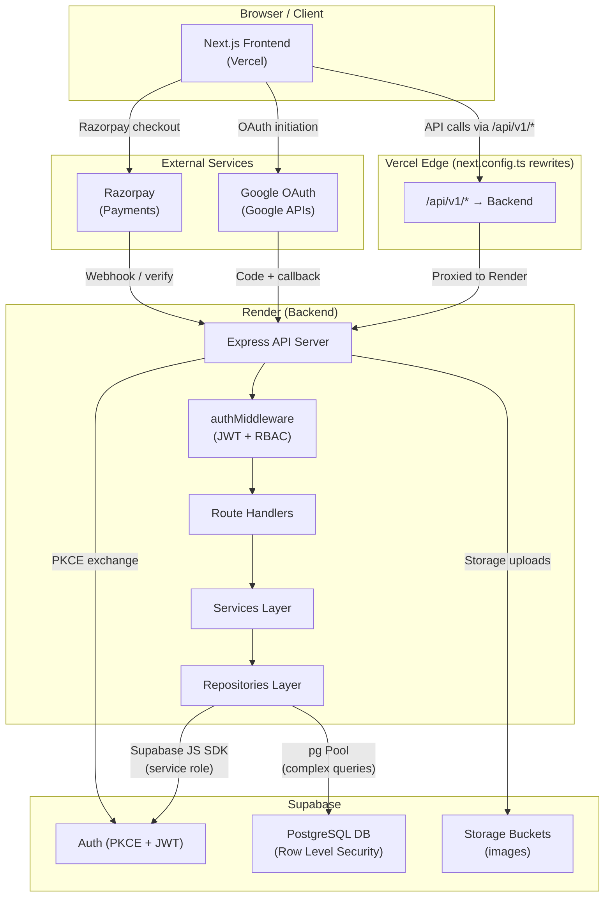

# Hospitality Hub: A Hotel Booking and Management System for Manali

> A full-stack hotel booking and management platform purpose-built for Manali, Himachal Pradesh. Guests can discover rooms, explore local attractions, and book stays with integrated payments. Admins and Super Admins manage the entire property through a dedicated dashboard.

---

## Table of Contents

1. [Project Overview](#1-project-overview)
2. [Features](#2-features)
3. [Technology Stack](#3-technology-stack)
4. [Architecture](#4-architecture)
5. [Project Structure](#5-project-structure)
6. [Installation and Local Setup](#6-installation-and-local-setup)
7. [Environment Variables](#7-environment-variables)
8. [Database Documentation](#8-database-documentation)
9. [API Documentation](#9-api-documentation)
10. [Authentication, Roles, and Security](#10-authentication-roles-and-security)
11. [Deployment](#11-deployment)
12. [Testing and Troubleshooting](#12-testing-and-troubleshooting)
13. [Future Improvements](#13-future-improvements)

---

## 1. Project Overview

**Hospitality Hub** is a production-ready hotel management system tailored to the Manali tourism experience. It serves two audiences:

| Audience | What they get |
|----------|--------------|
| **Guests** | Browse rooms, use the "Find My Perfect Stay" recommender, book with Razorpay, review stays, and access a Manali travel guide (places, activities, food, transport, weather tips, packing guides) |
| **Staff / Admins** | Manage bookings, rooms, users, housekeeping, maintenance, revenue reports, settings, and notifications through a role-protected admin dashboard |

The system is deployed with the **frontend on Vercel** and **backend on Render**, backed by a **Supabase PostgreSQL** database.

---

## 2. Features

### Guest-Facing
- **Registration & Login** — Email/password registration and login with JWT session cookies
- **Google OAuth** — One-click sign-in via Google, with PKCE flow and cookie-based session hand-off
- **Room Browsing & Filtering** — Browse all rooms with filters for type, price, capacity, amenities, and availability
- **Find My Perfect Stay** — Six-step guided questionnaire that recommends suitable rooms based on guest preferences (group size, budget, room type, stay purpose, amenities, number of rooms)
- **Room Detail Pages** — Full room information, photo gallery, and availability picker
- **Razorpay Payment Integration** — Secure payment order creation and server-side verification
- **Booking Management** — View, track, and cancel personal bookings; download PDF invoices
- **Reviews & Ratings** — Submit and view ratings after a completed stay
- **Manali Travel Guide** — Curated local content: destinations, activities, food, transport options, weather tips, packing guides, and emergency contacts
- **Partner Shops & Offers** — Browse partner businesses and available offers
- **Coupon System** — Generate and redeem discount coupons
- **Favorites** — Save places, activities, and food items to a personal favorites list
- **Spa Bookings** — Book spa treatments
- **Dining Reservations** — Reserve restaurant tables
- **Fitness Centre Access** — View fitness-centre details and book sessions
- **Notifications** — In-app notifications with mark-as-read and mark-all-read

### Admin Dashboard
- **User Management** — View, create, edit (role, status, password), and soft-delete users
- **Role-Based Dropdown** — Super Admin role option visible only to Super Admin actors
- **Room Management** — Add, edit, update status, and remove room listings
- **Booking Management** — View all bookings, update statuses (confirmed, cancelled, etc.)
- **Revenue Dashboard** — Charts and metrics for revenue, occupancy, and booking trends
- **Reviews Moderation** — Toggle review visibility
- **Housekeeping Module** — Create and manage housekeeping requests and task assignments
- **Maintenance Module** — Log and track maintenance requests; technicians can update/verify status
- **Audit Logs** — Admin and auth audit trails
- **Hotel Settings & DB Sync** — Update hotel profile, contact info, tax rate, check-in/out times, and synchronize settings with PostgreSQL

### Super Admin
- All Admin capabilities
- Promote or demote users to/from the Super Admin role
- Full access to Super Admin dashboard stats
- Can alter or delete Super Admin accounts (other admins cannot)

---

## 3. Technology Stack

### Frontend
| Technology | Version | Purpose |
|-----------|---------|---------|
| Next.js | 16.2.9 | React framework, App Router, API rewrites |
| React | 19.2.4 | UI rendering |
| TypeScript | ^5 | Type safety |
| Tailwind CSS | ^4 | Utility-first styling |
| Framer Motion | ^12 | Animations and transitions |
| Lucide React | ^1.21 | Icon library |
| TanStack React Query | ^5 | Server state management, caching, mutations |
| Axios | ^1.18 | HTTP client |
| Recharts | ^3.9 | Revenue/analytics charts |
| react-hot-toast | ^2.6 | Toast notifications |
| Zod | (via backend) | Runtime schema validation |
| shadcn/ui | ^4 | Component primitives |

### Backend
| Technology | Version | Purpose |
|-----------|---------|---------|
| Node.js | 20.x | Runtime |
| Express | ^4.18 | HTTP framework |
| TypeScript | ^5 | Type safety |
| Supabase JS | ^2.110 | Auth admin, database access |
| `pg` (node-postgres) | ^8 | Direct PostgreSQL pool for complex queries |
| jsonwebtoken | ^9 | JWT session tokens |
| Helmet | ^7 | HTTP security headers |
| express-rate-limit | ^8 | Rate limiting (global + dedicated OAuth limiter) |
| Zod | ^3 | Request validation schemas |
| Morgan | ^1.10 | HTTP access logging |
| cookie-parser | ^1.4 | Cookie parsing |
| compression | ^1.7 | Response compression |
| multer | ^2 | File uploads |
| node-cron | ^3 | Scheduled background jobs |
| pdfkit | ^0.17 | PDF invoice generation |
| date-fns | ^4 | Date utilities |
| Razorpay SDK | (installed) | Payment order creation and verification |
| nodemon + ts-node | dev | Hot-reload development server |

### Database & Infrastructure
| Component | Details |
|-----------|---------|
| Supabase | Hosted PostgreSQL, Auth (PKCE OAuth), Storage buckets, Row Level Security |
| PostgreSQL | ^15 (via Supabase) |
| Vercel | Frontend hosting with edge rewrites proxying to backend |
| Render | Backend hosting (free tier, auto-deploy from `main`) |

---

## 4. Architecture

### System Diagram



### Key Architectural Decisions

| Decision | Rationale |
|----------|-----------|
| Vercel rewrites `/api/v1/*` to Render backend | Avoids CORS; frontend and API appear same-origin |
| Backend uses Supabase **service role key** | Bypasses RLS for all server-side ops; RLS protects direct Supabase API access from external clients |
| PKCE OAuth with HTML redirect | Prevents Render proxy from stripping `Set-Cookie` headers during 3xx redirects; cookies are set via a 200 response with JS redirect |
| Dual DB access: Supabase JS SDK + pg Pool | SDK for auth and simple CRUD; pg Pool for overlap/availability queries requiring `SERIALIZABLE` isolation |
| Separate `oauthLimiter` (60/15 min) from `globalLimiter` (300/min) | Prevents background API polling from consuming the OAuth rate budget on Render's free tier |

---

## 5. Project Structure

```
hospitality-hub/
├── package.json                  # Root workspace (concurrently, dev scripts)
├── README.md
│
├── frontend/                     # Next.js App Router frontend
│   ├── app/
│   │   ├── admin/                # Admin-only pages (bookings, rooms, reviews, settings, users)
│   │   ├── dashboard/            # Guest dashboard (bookings, explore, dining, fitness, spa,
│   │   │                         #   housekeeping, maintenance, rooms, settings, shopping, revenue)
│   │   ├── rooms/                # Public room listing + detail ([id])
│   │   ├── explore/              # Find My Perfect Stay questionnaire
│   │   ├── checkout/[roomId]/    # Booking + Razorpay payment flow
│   │   ├── login/ register/      # Auth pages
│   │   ├── shopping/             # Partner shops + offers
│   │   ├── fitness/ services/    # Service pages
│   │   └── ...                   # faqs, privacy-policy, cancellation-policy, etc.
│   ├── components/
│   │   ├── dashboard/            # AdminGuard, UsersTable, UserFormModal, ...
│   │   ├── admin/                # AdminGuard
│   │   ├── auth/                 # ProtectedRoute
│   │   └── shared/               # StatusBadge, shared UI
│   ├── providers/
│   │   └── AuthProvider.tsx      # Auth context, /users/me, login/logout/refresh
│   ├── lib/
│   │   └── api.ts                # Axios instance (baseURL=/api/v1, withCredentials)
│   ├── types/
│   │   └── auth.ts               # User, UserRole, AuthContextType
│   └── next.config.ts            # Rewrites + image domains
│
├── backend/
│   ├── src/
│   │   ├── server.ts             # HTTP server bootstrap
│   │   ├── app.ts                # Express app (trust proxy, CORS, helmet, middleware, routes)
│   │   ├── config/
│   │   │   ├── env.ts            # Zod-validated env schema
│   │   │   ├── supabase.ts       # Supabase service-role client
│   │   │   └── database.ts       # pg Pool
│   │   ├── routes/               # Route files (auth, users, rooms, bookings, payments,
│   │   │                         #   hotels, reviews, housekeeping, maintenance, manali,
│   │   │                         #   shopping, notifications, spa, fitness, restaurant,
│   │   │                         #   superAdmin, upload, availability, dashboard)
│   │   ├── controllers/          # Request handlers
│   │   ├── services/             # Business logic (Auth, User, Hotel, Booking, ...)
│   │   ├── domain/
│   │   │   ├── entities/         # TypeScript entity interfaces
│   │   │   └── repositories/
│   │   │       ├── IHotelRepository.ts
│   │   │       └── postgres/     # pg-based repository implementations
│   │   ├── middleware/
│   │   │   ├── authMiddleware.ts # authenticate, requirePermission, requireSuperAdmin, allowRoles
│   │   │   ├── rateLimiter.ts    # globalLimiter + oauthLimiter
│   │   │   └── errorHandler.ts
│   │   ├── utils/
│   │   │   ├── AppError.ts       # Typed error class
│   │   │   └── dbMigrator.ts     # Auto-runs SQL migration files on startup
│   │   └── validations/          # Zod request schemas
│   └── supabase/
│       └── migrations/           # 17 SQL migration files (003–017)
```

---

## 6. Installation and Local Setup

### Prerequisites

- Node.js ≥ 20
- npm ≥ 9
- A Supabase project (free tier is sufficient)
- A Google Cloud project with OAuth 2.0 credentials
- A Razorpay account (test mode)

### Clone the Repository

```bash
git clone https://github.com/PreetKhunt/Hotel-Managment.git
cd Hotel-Managment
```

### Install All Dependencies

```bash
# Install root, frontend, and backend dependencies in one command
npm run install:all
```

Or install separately:

```bash
cd frontend && npm install
cd ../backend && npm install
```

### Configure Environment Variables

**Backend** — create `backend/.env`:

```env
# See Section 7 for full variable reference
PORT=5000
NODE_ENV=development
DATABASE_URL=YOUR_SUPABASE_POSTGRES_URL
SUPABASE_URL=YOUR_SUPABASE_URL
SUPABASE_ANON_KEY=YOUR_SUPABASE_ANON_KEY
SUPABASE_SERVICE_ROLE_KEY=YOUR_SUPABASE_SERVICE_ROLE_KEY
SUPABASE_JWT_SECRET=YOUR_SUPABASE_JWT_SECRET
GOOGLE_CLIENT_ID=YOUR_GOOGLE_CLIENT_ID
GOOGLE_CLIENT_SECRET=YOUR_GOOGLE_CLIENT_SECRET
GOOGLE_CALLBACK_URL=http://localhost:5000/api/v1/auth/google/callback
RAZORPAY_KEY_ID=YOUR_RAZORPAY_KEY_ID
RAZORPAY_KEY_SECRET=YOUR_RAZORPAY_KEY_SECRET
CORS_ORIGIN=http://localhost:3001
```

**Frontend** — create `frontend/.env.local`:

```env
NEXT_PUBLIC_BACKEND_URL=http://localhost:5000/api/v1
```

### Run Database Migrations

Migrations run automatically on backend startup via `dbMigrator.ts`. To apply them manually, run each file in `backend/supabase/migrations/` in numeric order against your Supabase SQL Editor:

```
Supabase Dashboard → SQL Editor → paste and run each migration file
```

> [!IMPORTANT]
> Migration `017_enable_rls_and_super_admin.sql` must be run in the Supabase SQL Editor if your local `DATABASE_URL` does not have direct PostgreSQL access (PgBouncer pooler mode blocks session-level DDL).

### Start Development Servers

```bash
# From the repo root — starts both frontend (port 3001) and backend (port 5000)
npm run dev

# Or start individually:
npm run dev:backend    # Express on port 5000
npm run dev:frontend   # Next.js on port 3001
```

### Build for Production

```bash
# Frontend
cd frontend && npm run build

# Backend
cd backend && npm run build   # tsc → dist/
```

---

## 7. Environment Variables

> [!CAUTION]
> **Never commit real secrets.** The `.env` and `.env.local` files are git-ignored. Never add API keys, database passwords, OAuth secrets, JWT secrets, service-role keys, or Razorpay credentials to version control.

### Backend (`backend/.env`)

| Variable | Required | Purpose |
|----------|----------|---------|
| `PORT` | No (default: 5000) | Express listening port |
| `NODE_ENV` | Yes | `development` \| `production` \| `test` |
| `DATABASE_URL` | Yes | Supabase PostgreSQL connection string (PgBouncer URL from Supabase dashboard) |
| `SUPABASE_URL` | Yes | Your Supabase project URL (`https://<ref>.supabase.co`) |
| `SUPABASE_ANON_KEY` | Yes | Supabase anonymous/public key |
| `SUPABASE_SERVICE_ROLE_KEY` | Yes | **Server-side only** — service role key; bypasses RLS |
| `SUPABASE_JWT_SECRET` | Yes | Used to verify Supabase-issued JWTs |
| `GOOGLE_CLIENT_ID` | Yes | Google OAuth 2.0 client ID |
| `GOOGLE_CLIENT_SECRET` | Yes | **Server-side only** — Google OAuth 2.0 client secret |
| `GOOGLE_CALLBACK_URL` | Yes | OAuth redirect URI (must match Google Console config) |
| `RAZORPAY_KEY_ID` | Yes | Razorpay API key ID (safe to expose in test mode) |
| `RAZORPAY_KEY_SECRET` | Yes | **Server-side only** — Razorpay secret key |
| `CORS_ORIGIN` | No (default: `http://localhost:3001`) | Allowed CORS origin |
| `RENDER_EXTERNAL_URL` | No | Set by Render automatically; used to auto-build OAuth callback URL |
| `LOG_LEVEL` | No (default: `info`) | Morgan/winston log level |

**Optional feature flags** (default to enabled if not set):

| Variable | Purpose |
|----------|---------|
| `FEATURE_GOOGLE_LOGIN` | Enable/disable Google OAuth route |
| `FEATURE_PASSWORD_LOGIN` | Enable/disable email/password login |
| `FEATURE_EMAIL_REGISTRATION` | Enable/disable new registrations |
| `SESSION_TIMEOUT_MINUTES` | JWT session TTL |
| `JWT_EXPIRES_IN` | JWT expiry string (e.g. `7d`) |
| `LOCKOUT_MAX_ATTEMPTS` | Failed login attempts before lockout |
| `LOCKOUT_DURATION_MINUTES` | Lockout window |
| `PASSWORD_MIN_LENGTH` | Minimum password length |

### Frontend (`frontend/.env.local`)

| Variable | Required | Purpose |
|----------|----------|---------|
| `NEXT_PUBLIC_BACKEND_URL` | No (has default) | Backend API base URL used by the Next.js rewrite config |
| `BACKEND_API_URL` | No | Server-side override for the backend URL in `next.config.ts` |

> [!NOTE]
> In production, the Vercel Next.js rewrite proxies all `/api/v1/*` calls to the Render backend — no public backend URL is exposed to the browser.

---

## 8. Database Documentation

### Migration History

| File | Contents |
|------|---------|
| `003_booking_engine.sql` | Bookings, availability, idempotency keys |
| `004_invoices_cancellations.sql` | Invoices, cancellation policies, audit logs |
| `005_production_readiness.sql` | Indexes, triggers, performance |
| `006_authentication.sql` | Roles, permissions, role_permissions, users table, `handle_new_user` trigger |
| `007_hotel_domain.sql` | Hotels, hotel_settings, rooms, room_images, hotel_images |
| `008_fitness_module.sql` | Fitness sessions and bookings |
| `009_reviews_seed.sql` | Reviews table + seed data |
| `010_super_admin.sql` | Super Admin role, `SUPER_ADMIN` permission |
| `011_storage_buckets.sql` | Supabase Storage bucket configuration |
| `012_housekeeping_and_maintenance.sql` | Housekeeping requests, maintenance requests, audit logs |
| `013_manali_and_shopping.sql` | Manali places, activities, food, tips, guides, transport; partner shops, offers, coupons |
| `014_manali_seed.sql` | Seed data for Manali travel content |
| `015_manali_shopping_complete_seed.sql` | Extended seed data for shops/offers |
| `016_fix_broken_image_urls.sql` | Image URL fixes |
| `017_enable_rls_and_super_admin.sql` | RLS enabled + least-privilege policies for 13 tables; idempotent Super Admin assignment |
| `20260703162904_public_read_rooms.sql` | Public read policy for rooms |

### Key Tables

| Table | Description |
|-------|-------------|
| `public.users` | All application users; linked to `auth.users` via `id` |
| `public.roles` | Named roles (Guest, Staff, Receptionist, Manager, Admin, Super Admin) |
| `public.permissions` | Permission names (e.g. `full_access`, `view_guests`, `SUPER_ADMIN`) |
| `public.role_permissions` | Many-to-many role ↔ permission mapping |
| `public.hotels` | Hotel records |
| `public.hotel_settings` | Hotel configuration (name, tax, check-in/out, contact, etc.) |
| `public.rooms` | Room listings with type, capacity, price, status |
| `public.room_images` / `hotel_images` | Image URLs for rooms and the hotel |
| `public.bookings` | Guest reservations with status lifecycle |
| `public.invoices` | Generated invoices linked to bookings |
| `public.idempotency_keys` | Prevents duplicate payment/booking operations |
| `public.booking_audit_logs` | Immutable booking status change history |
| `public.admin_audit_logs` | Admin action audit trail |
| `public.auth_audit_logs` | Auth event log |
| `public.reviews` | Guest reviews and ratings |
| `public.notifications` | Per-user in-app notifications |
| `public.housekeeping_requests` | Housekeeping task management |
| `public.maintenance_requests` | Maintenance issue tracking |
| `public.manali_places` etc. | Manali travel content tables |
| `public.partner_shops` / `partner_offers` | Partner business listings |
| `public.coupons` | Discount coupon records |
| `public.user_settings` | Per-user settings/preferences |

### Row Level Security

RLS is enabled on all 13 Supabase Advisor-flagged tables (Migration 017). Key policies:

- `room_images`, `hotel_images` — Public `SELECT`; Admin `INSERT/UPDATE/DELETE`
- `hotels` — Public `SELECT` where `status = 'active'`; Admin write
- `hotel_settings` — Authenticated hotel staff `SELECT`; Admin write
- `invoices` — Owner-only `SELECT` (via booking join) + staff `SELECT`; Admin write
- `user_settings` — Owner CRUD; Admin `SELECT`
- `idempotency_keys` — Service role only (fully locked)
- `booking_audit_logs` — Staff `SELECT` only
- `admin_audit_logs` — Super Admin `SELECT` only
- `auth_audit_logs` — Admin/Super Admin `SELECT` only
- `roles`, `permissions`, `role_permissions` — Authenticated `SELECT`; Super Admin write only

All backend operations use the **service role key** and bypass RLS — RLS protects against direct API access from external clients.

---

## 9. API Documentation

All endpoints are prefixed with `/api/v1`. Authentication uses an `hh_session` cookie containing a JWT.

### Authentication

| Method | Endpoint | Auth | Description |
|--------|----------|------|-------------|
| `POST` | `/auth/login` | — | Email/password login |
| `POST` | `/auth/register` | — | Create new account |
| `POST` | `/auth/logout` | Cookie | Clear session |
| `GET` | `/auth/google` | — | Initiate Google OAuth (PKCE) |
| `GET` | `/auth/google/callback` | — | Handle OAuth code exchange |

### Users

| Method | Endpoint | Auth | Description |
|--------|----------|------|-------------|
| `GET` | `/users/me` | Cookie | Get current user profile |
| `PUT` | `/users/me` | Cookie | Update own profile |
| `GET` | `/users` | Admin | List all users |
| `POST` | `/users` | Admin | Create user |
| `PUT` | `/users/:id` | Admin | Update user (name, role, status, password) |
| `PUT` | `/users/:id/role` | Admin | Update user role only |
| `PUT` | `/users/:id/status` | Admin | Update user status only |
| `DELETE` | `/users/:id` | Admin | Soft-delete user |

### Rooms

| Method | Endpoint | Auth | Description |
|--------|----------|------|-------------|
| `GET` | `/rooms` | — | List available rooms |
| `GET` | `/rooms/:id` | — | Room detail |

### Bookings

| Method | Endpoint | Auth | Description |
|--------|----------|------|-------------|
| `GET` | `/bookings` | Cookie | List own bookings |
| `POST` | `/bookings` | Cookie | Create booking |
| `GET` | `/bookings/:id` | Cookie | Booking detail |
| `PATCH` | `/bookings/:id/cancel` | Cookie | Cancel booking |
| `GET` | `/bookings/:id/invoice` | Cookie | Download PDF invoice |

### Payments

| Method | Endpoint | Auth | Description |
|--------|----------|------|-------------|
| `POST` | `/payment/verify` | Cookie | Verify Razorpay payment signature |

### Hotel Settings

| Method | Endpoint | Auth | Description |
|--------|----------|------|-------------|
| `GET` | `/hotels/settings` | Cookie | Fetch hotel settings |
| `PUT` | `/hotels/settings` | Admin | Update and sync hotel settings |

### Reviews

| Method | Endpoint | Auth | Description |
|--------|----------|------|-------------|
| `GET` | `/reviews` | — | List public reviews |
| `POST` | `/reviews` | Cookie | Submit review |

### Housekeeping

| Method | Endpoint | Auth | Description |
|--------|----------|------|-------------|
| `GET` | `/housekeeping/requests` | Staff | List requests |
| `POST` | `/housekeeping/requests` | Staff | Create request |
| `PATCH` | `/housekeeping/requests/:id/status` | Staff | Update status |

### Maintenance

| Method | Endpoint | Auth | Description |
|--------|----------|------|-------------|
| `GET` | `/maintenance/requests` | Staff | List requests |
| `POST` | `/maintenance/requests` | Staff | Log issue |
| `PATCH` | `/maintenance/requests/:id/status` | Technician | Update status |
| `POST` | `/maintenance/requests/:id/verify` | Technician | Verify resolution |

### Manali Travel Guide

| Method | Endpoint | Auth | Description |
|--------|----------|------|-------------|
| `GET` | `/manali/places` | — | Manali destinations |
| `GET` | `/manali/activities` | — | Local activities |
| `GET` | `/manali/food` | — | Food & dining |
| `GET` | `/manali/packing-guides` | — | Packing guidance |
| `GET` | `/manali/weather-tips` | — | Weather advice |
| `GET` | `/manali/travel-tips` | — | General travel tips |
| `GET` | `/manali/emergency-contacts` | — | Emergency numbers |
| `GET` | `/manali/transport` | — | Transport options |
| `GET/POST/DELETE` | `/manali/favorites` | Cookie | Personal favorites |

### Shopping

| Method | Endpoint | Auth | Description |
|--------|----------|------|-------------|
| `GET` | `/shopping/shops` | — | Partner shops |
| `GET` | `/shopping/offers` | — | Current offers |
| `POST` | `/shopping/coupons/generate` | Cookie | Generate coupon |
| `POST` | `/shopping/coupons/redeem` | Cookie | Redeem coupon |
| `GET` | `/shopping/coupons/my-coupons` | Cookie | Own coupons |

### Notifications

| Method | Endpoint | Auth | Description |
|--------|----------|------|-------------|
| `GET` | `/notifications` | Cookie | List notifications |
| `PATCH` | `/notifications/:id/read` | Cookie | Mark as read |
| `PATCH` | `/notifications/mark-all-read` | Cookie | Mark all read |

### Super Admin (`/super-admin/*`)

All routes require `authenticate` + `requireSuperAdmin()` middleware.

| Method | Endpoint | Description |
|--------|----------|-------------|
| `GET` | `/super-admin/dashboard/stats` | Dashboard KPIs |
| `GET/POST/PUT/DELETE` | `/super-admin/rooms` | Full room management |
| `GET/PATCH` | `/super-admin/bookings` | All bookings + status updates |
| `GET/PATCH` | `/super-admin/users` | User list + role/status changes |
| `GET/PATCH` | `/super-admin/reviews` | Reviews + visibility toggle |
| `GET/PUT` | `/super-admin/settings` | Hotel settings |
| `GET` | `/super-admin/logs` | Audit logs |

---

## 10. Authentication, Roles, and Security

### Google OAuth Flow

```
1. Guest clicks "Sign in with Google"
2. Frontend navigates to GET /api/v1/auth/google?next=<returnUrl>
3. Backend generates PKCE code verifier → stores in a Supabase cookie
4. Backend returns 200 HTML page that JS-redirects browser to Google's OAuth URL
   (200 not 302 — avoids Render proxy stripping Set-Cookie on redirects)
5. Google authenticates the user, redirects to /api/v1/auth/google/callback?code=...
6. Backend exchanges code for a Supabase session (PKCE verifier read from cookie)
7. Backend signs an hh_session JWT, sets it as an HttpOnly cookie
8. Browser is redirected to the frontend `next` URL
```

### Session Handling

- Sessions are stored as **HttpOnly, SameSite=None, Secure** cookies named `hh_session`
- On each request, `authMiddleware.ts` verifies the JWT, queries the user + role + permissions, and attaches `req.user`
- Frontend reads user state via `GET /users/me`; the `AuthProvider` caches it in React state and React Query

### Roles and Permissions

| Role | Key Permissions |
|------|----------------|
| **Guest** | View rooms, bookings, profile |
| **Staff** | + Housekeeping and maintenance access |
| **Receptionist** | + View guest list |
| **Manager** | + `full_access` (manage bookings, rooms) |
| **Admin** | + Full admin dashboard; cannot modify Super Admins |
| **Super Admin** | All permissions + manage Super Admin accounts |

### Security Practices

- **Never expose `SUPABASE_SERVICE_ROLE_KEY`** outside the backend server
- **RAZORPAY_KEY_SECRET** must remain server-side; payment signatures are verified server-side before any booking is confirmed
- **Super Admin escalation** is blocked in `UserService.updateUserRole()` — a 403 is returned if a non-Super Admin attempts to assign the Super Admin role, even via direct API call
- **Rate limiting**: a dedicated `oauthLimiter` (60 req/15 min) guards OAuth routes; the global limiter (300 req/min) skips OAuth paths to prevent background polling from consuming OAuth quota
- **`trust proxy = true`** is set so Express reads the real client IP from Render's + Vercel's proxy chain for accurate rate-limiting

---

## 11. Deployment

### Live URLs

| Service | URL |
|---------|-----|
| Frontend (Vercel) | `https://hotel-managment-alpha.vercel.app` |
| Backend (Render) | `https://hotel-management-backend-s0s0.onrender.com` |
| Supabase Project | `https://vuqsfbhhgjpztoqmpmle.supabase.co` |

### Frontend — Vercel

1. Connect the GitHub repository to Vercel
2. Set **Root Directory** to `frontend`
3. Framework: Next.js (auto-detected)
4. Set environment variable:
   ```
   BACKEND_API_URL = https://hotel-management-backend-s0s0.onrender.com/api/v1
   ```
5. Deploy — Vercel auto-deploys on every push to `main`

### Backend — Render

1. Connect the GitHub repository to Render as a **Web Service**
2. Set **Root Directory** to `backend`
3. Build Command: `npm install && npm run build`
4. Start Command: `node dist/server.js`
5. Set all required environment variables from [Section 7](#7-environment-variables)
6. Render auto-deploys on every push to `main`

> [!NOTE]
> Render's free tier hibernates after 15 minutes of inactivity. The first request after hibernation may be slow (cold start). The OAuth PKCE flow uses a 200+JS-redirect workaround specifically because Render can strip cookies on 302 responses during hibernation wake-up.

### Database — Supabase

1. Create a Supabase project
2. Go to **SQL Editor** and run migration files from `backend/supabase/migrations/` in order (003 → 017)
3. Copy the **Project URL**, **Anon Key**, **Service Role Key**, **JWT Secret**, and **Database Connection String** (PgBouncer URL for `DATABASE_URL`) into your backend environment variables
4. Configure Google OAuth in **Authentication → Providers → Google** with your Client ID and Secret

### Google OAuth — Required Console Config

In [Google Cloud Console](https://console.cloud.google.com/):
- Authorized redirect URIs must include:
  - `https://hotel-management-backend-s0s0.onrender.com/api/v1/auth/google/callback` (production)
  - `http://localhost:5000/api/v1/auth/google/callback` (development)

---

## 12. Testing and Troubleshooting

### Build & Validation Commands

```bash
# Frontend
cd frontend
npx tsc --noEmit        # TypeScript check
npm run lint            # ESLint
npm run build           # Production build

# Backend
cd backend
npx tsc --noEmit        # TypeScript check
npm run build           # Compile TypeScript → dist/
```

### Common Issues

#### "PKCE code verifier not found"
- **Cause**: The OAuth flow was started in a different browser/tab, or the Supabase cookie was not set before the callback arrived
- **Fix**: Clear browser cookies for the backend domain and try again; ensure the backend is not hibernated when the flow starts

#### "Too Many Requests" on Google Sign-In
- **Cause**: Render free-tier hibernation rate-limiting during cold start
- **Fix**: Wait ~30 seconds and retry; the dedicated `oauthLimiter` prevents background polling from eating the OAuth rate budget

#### "multiple assignments to same column hotel_name"
- **Cause**: The settings sync payload previously sent both `hotel_name` and `hotelName` which both mapped to the same database column
- **Status**: **Fixed** in `HotelSettingsRepository.ts` — the update loop now deduplicates by DB column name

#### Settings sync returns 404
- **Cause**: No `hotel_settings` row exists for the hotel ID
- **Fix**: Insert a row via the Supabase SQL Editor or the Super Admin settings panel before syncing

#### CORS errors in development
- Ensure `CORS_ORIGIN=http://localhost:3001` in backend `.env` and that the frontend dev server is on port 3001 (`npm run dev` in the frontend uses `-p 3001`)

#### Database migration fails locally
- The `DATABASE_URL` PgBouncer connection string from Supabase doesn't support session-level DDL (like `CREATE POLICY`)
- **Fix**: Run migrations directly in the Supabase SQL Editor

#### Backend build fails (`tsc`)
- Ensure you're using Node.js ≥ 20: `node --version`
- Run `npm install` in the `backend/` directory before building

---

## 13. Future Improvements

The following features are planned or partially scaffolded but not yet fully implemented:

- **Email notifications** — SMTP integration for booking confirmations, reminders, and password resets
- **Multi-hotel support** — The data model supports multiple hotels; the UI currently targets a single property
- **Real-time availability** — WebSocket or SSE for live room availability updates
- **Expanded review system** — Per-room ratings, photo attachments, and manager replies
- **PWA / mobile app** — Progressive Web App manifest and offline support
- **Advanced reporting** — Export-to-CSV for bookings, revenue, and occupancy reports
- **CMS for Manali content** — Admin UI to manage travel guide content without direct SQL
- **Loyalty program** — Guest points and rewards linked to completed stays
- **AI room recommender** — Replace the rule-based recommender with an ML model trained on stay history

---

<div align="center">
  <sub>Made with ❤️ by Preet </sub>
</div>
